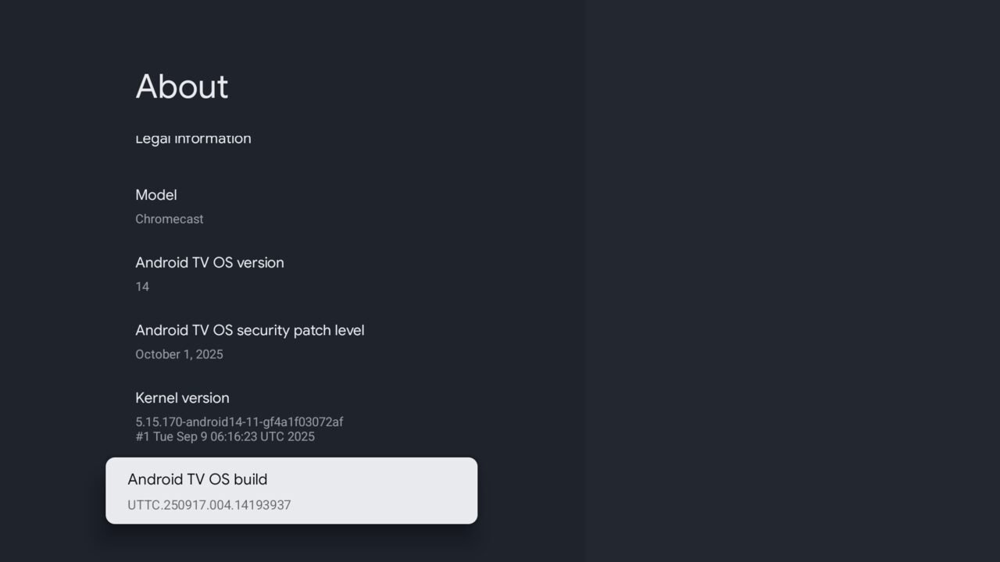
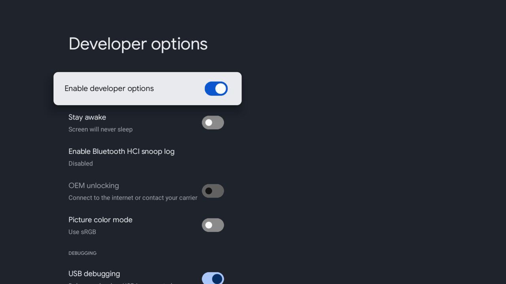
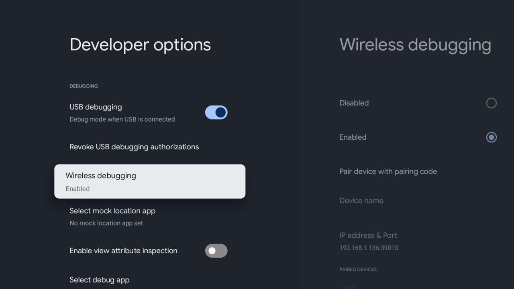

# Clean Home Companion

A free helper for **Clean Home**, the calm launcher for Google TV (coming to Google Play).

A TV will not let an app do a few small jobs alone. This helper does them for you, from a computer, in about 10 minutes. You can read every command it runs in this repo.

**What it does**
- Turns on **Watch Next** cards in Clean Home (the "Continue Watching" row).
- Turns on the **Home button helper**, so the Home button opens Clean Home.
- Optionally removes clutter (telemetry, ad services, apps you never use). Nothing is uninstalled. One command undoes it.

**What it never does**
- It never uninstalls anything. It only turns apps off, and it can turn them back on.
- It never touches Google's home screen or the setup wizard (that can break casting).
- It never touches core Android apps.
- It never touches **Google's screensaver**, so your Google Photos album on idle keeps working.
- It changes nothing until you say so. The clean-up shows a plan first.

Tested on: **Chromecast with Google TV 4K**, Google TV 14. Other TVs may work, but run `status` and read the plan first.

---

## Before you start
You need:
- Clean Home installed on the TV.
- The TV and your computer on the **same Wi-Fi**.
- A computer with `adb` (Android platform-tools): [download](https://developer.android.com/tools/releases/platform-tools). On Windows, use Git Bash or WSL for the script.

---

## Part 1. On the TV (3 minutes)

### Step 1. Open Developer options
1. On the TV: **Settings → System → About**.
2. Scroll down to **Android TV OS build**.
3. Press **OK** on it **7 times**. The TV says you are now a developer.



4. Press **Back**. A new item, **Developer options**, now sits in **Settings → System**.



### Step 2. Turn on Wireless debugging
1. In **Developer options**, scroll to **Wireless debugging**.
2. Choose **Enabled**.
3. Keep this screen. It shows your TV's **IP address & Port** (for example `192.168.1.136:39013`). You need it later.



### Step 3. Pair your computer (once)
1. On the TV, choose **Pair device with pairing code**. The TV shows a 6-digit code, an IP and a **pairing port**. The pairing port is not the same as the main port.
2. On your computer:
```
adb pair <ip>:<pairing port>
```
Type the 6-digit code when asked. You should see `Successfully paired`.
3. Connect, using the main **IP address & Port** from step 2:
```
adb connect <ip>:<port>
adb devices
```
The TV should show as `device`.

> The port changes after a TV restart. Read it again from the Wireless debugging screen.

---

## Part 2. On the computer (5 minutes)

Download this repo (green **Code** button, then **Download ZIP**, or `git clone`). Open a terminal in the folder, then:

```
export TV=<ip>:<port>
```

### Look first (changes nothing)
```
./scripts/clean-home-setup.sh status
```
You should see something like:
```
model:    Chromecast (sabrina)
android:  14  build UTTC.250917.004.14193937
home:     com.cleanhome.tv
disabled: 11 packages
clean home: installed, versionName=0.1.0
watch next access: granted
home helper: on
```

### Turn on Watch Next
```
./scripts/clean-home-setup.sh watchnext
```
Then, on the TV, open Clean Home: **Settings → Watch Next → Show on Home**.
(Doing it by hand instead: `adb shell pm grant com.cleanhome.tv android.permission.READ_TV_LISTINGS`.)

### Turn on the Home button helper
```
./scripts/clean-home-setup.sh helper
```
Press Home on the remote. Clean Home should open.

### Remove clutter (optional)
First, a dry run. It only shows a plan:
```
./scripts/clean-home-setup.sh debloat
```
```
skip (already off): com.google.android.feedback
...
to disable: 2
  com.google.android.tv.remotecontrol.logging
  com.google.android.videos
dry run. Add --apply to do it.
```
If the plan looks right:
```
./scripts/clean-home-setup.sh debloat --apply
```
The script saves what was already off, turns the listed apps off one by one, and checks the home screen after each one. If Home ever changes, it turns everything back on by itself and stops.

After that, do two quick checks:
- Cast something from your phone to the TV.
- Let the TV idle and see your screensaver.

### Undo
```
./scripts/clean-home-setup.sh restore
```
This turns back on only what the script turned off.

### When you are done
On the TV, turn **Wireless debugging** off again (Developer options).

---

## If something goes wrong
| What you see | What to do |
| --- | --- |
| `cannot reach <ip>:<port>` | The port changed. Read it again on the TV and run `adb connect` again. |
| `adb devices` shows `offline` or `unauthorized` | On the TV, accept the "Allow debugging" box. If it never appears, pair again (Part 1, step 3). |
| `STOP: the list holds a protected package` | The script refuses to touch core apps. Remove that line from the list. |
| `Home changed after ...` | The script already undid its changes. Run `status` and tell us. |
| The TV shows a Google setup or recovery screen after a step | Run `adb shell pm enable --user 0 com.google.android.apps.tv.launcherx`. Do **not** restart the TV. |
| Casting says "Untrusted device" | Something turned off Google's setup wizard (this script never does). Run `restore`, then turn the wizard back on: `adb shell pm enable --user 0 com.google.android.tungsten.setupwraith`. |
| The screensaver is black (no photos) | This script never touches it. See "A black screensaver" below. |

## A black screensaver
If your Google Photos screensaver shows only a black screen with the clock, the screensaver app could not load the pictures. We saw this on one TV that this script never touched. Clearing app caches fixed it there (`adb shell cmd package trim-caches 4G`; it keeps all app data), then stop the screensaver app once (`adb shell am force-stop com.google.android.apps.tv.dreamx`) so it reloads. A few pictures still failed to load afterwards, so we are watching it.

## Questions
**Is it safe?** Everything is `pm disable-user`, which Android lets you undo at any time. Nothing is deleted. A built-in block refuses core apps, Google's home screen, the setup wizard and the screensaver.

**Does it need root?** No.

**Why not disable Google's home screen, like other guides?** On this TV it can break casting and trap the TV on a recovery screen. Clean Home uses the Home button helper instead.

**Does it send anything anywhere?** No. It only talks to your TV on your own Wi-Fi.

**What about a phone app?** Planned. It will do the same steps from an Android phone, and it will live in this repo.

## Web pages (for Google Play)
Sources are in `docs/`. These addresses work only **after Pages is on** (GitHub Pages, branch `main`, folder `/docs`). Pages is not on yet.
- Privacy policy: https://felipecpaiva.github.io/clean-home-companion/privacy.html
- Watch Next how-to: https://felipecpaiva.github.io/clean-home-companion/watch-next.html

## Licence
MIT. See `LICENSE` and `NOTICE.md`.
